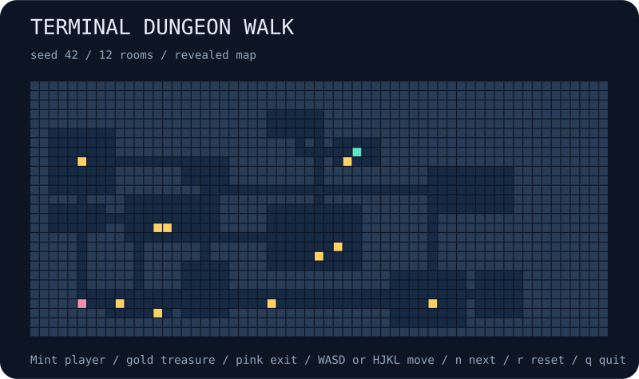

# terminal-dungeon-walk

Explore a seeded dungeon in your terminal. Uncover rooms through fog of war, pick up treasure, and find the exit. No enemies, timers, or combat: just a little map to discover.



## Run

```bash
npx --yes github:b69ca/terminal-dungeon-walk
npx --yes github:b69ca/terminal-dungeon-walk --seed 137
```

Node.js 20 or newer. No runtime dependencies. The game runs locally.

## Play

| Key | Action |
| --- | --- |
| `w` / `k` | Up |
| `d` / `l` | Right |
| `s` / `j` | Down |
| `a` / `h` | Left |
| `n` | Start the next seed |
| `r` | Restart the current seed |
| `q` or Ctrl-C | Quit and restore the terminal |

Use lowercase keys. `@` is you, `$` is treasure, `>` is the exit, `#` is a wall, and `.` is floor. Cells within sight are revealed; previously seen cells stay on the map, dimmed when colors are enabled. Walls block line of sight. Treasure is optional: reaching the exit wins immediately, then movement freezes until you restart or choose another seed.

## Export or replay

```bash
# Save a spoiler map, including every room and treasure
npx --yes github:b69ca/terminal-dungeon-walk --seed 42 --width 61 --height 27 --reveal --svg dungeon.svg

# Replay movement keys and print the resulting summary
npx --yes github:b69ca/terminal-dungeon-walk --moves wwddssaa --json

# Print an ASCII map instead of starting a live game
npx --yes github:b69ca/terminal-dungeon-walk --reveal > dungeon.txt
```

## Options

```text
--seed N       unsigned 32-bit seed (default: 42)
--width N      integer from 25 to 101
--height N     integer from 15 to 61
--vision N     sight radius from 1 to 12 (default: 5)
--moves KEYS   replay lowercase wasdhjkl keys before display
--reveal       show every cell, bypassing fog
--json         print summary statistics instead of playing
--svg FILE     save a static SVG instead of playing
--no-color     disable ANSI colors
--help         show usage
```

JSON and SVG can be combined. Without a TTY, the CLI prints one plain 61 × 27 snapshot without escape sequences. Live defaults fit the terminal at startup; specify dimensions to reproduce a map across terminals. `NO_COLOR=1` also disables colors. Quitting restores the screen, cursor, and input mode. Exit codes are 0 for success and 2 for argument or file errors.

JSON includes player and exit coordinates, room count, movement count, treasure totals, discovered-cell count, floor-cell count, and win status. Discovered cells include visible walls. The exit coordinates in JSON reveal its location even without `--reveal`.

## Under the hood

A local seeded PRNG places nonoverlapping rooms and joins their centers with orthogonal corridors. Every carved floor cell is connected. The exit is a farthest reachable cell from the starting room, measured by four-neighbor breadth-first distance. Up to ten treasure cells are sampled without replacement, excluding the start and exit.

Sight uses discrete rays within a circular radius, revealing the first blocking wall on each ray. It is a simple grid visibility model rather than exact geometric visibility. All map data is available in the library object; fog controls presentation, not access to hidden map data.

## Library

Install with `npm install github:b69ca/terminal-dungeon-walk`, then:

```js
import { createDungeon, move, analyze, renderSVG } from 'terminal-dungeon-walk';
const game = createDungeon({ seed: 42, width: 61, height: 27 });
move(game, 'right'); // Mutates game; returns whether movement succeeded.
console.log(analyze(game));
const svg = renderSVG(game, { all: true });
```

`cells`, `seen`, and `visible` are row-major `Uint8Array` grids. `cells` uses 1 for floor and 0 for wall. Player, exit, and treasure IDs use `y * width + x`. Renderers accept games created by `createDungeon()`.

## Development

```bash
npm ci
npm run check
```

Tests cover seeded generation, connectivity, farthest exits, winning routes, walls, treasure, visibility, replay, and exports. CI runs on Node.js 20, 22, and 24.

## License

MIT
